# AICTE SAKSHAM 2.0 — AI-Powered Application Scrutiny & Regulatory Verification Platform

[](https://www.sih.gov.in/)
[-blue.svg?style=flat-square)](https://www.aicte-india.org/)
[](https://www.aicte-india.org/ap2024-25/)
[](#section-65b-tamper-evident-audit-trail)
[](https://fastapi.tiangolo.com)
[](https://reactjs.org/)
[](#quick-start-with-docker-recommended)

> **All India Council for Technical Education (AICTE), Ministry of Education, Government of India**  
> **Department:** Regulation Bureau  
> **Statutory Regulatory Basis:** AICTE Approval Process Handbook (**APH 2024–2027**)  
> **Theme:** Smart Automation / Software Decision Support

---

## Table of Contents
1. [Executive Summary & Problem Statement](#executive-summary--problem-statement)
2. [Core Architectural Principles & Statutory Safeguards](#core-architectural-principles--statutory-safeguards)
3. [System Architecture](#system-architecture)
4. [End-to-End Scrutiny Data Flow Pipeline](#end-to-end-scrutiny-data-flow-pipeline)
5. [Feature Matrix & Architectural Implementation Details](#feature-matrix--architectural-implementation-details)
   - [1. Vector Text Extraction & Coordinate Normalization](#1-vector-text-extraction--resolution-independent-coordinate-normalization)
   - [2. Non-Destructive Error Level Analysis (ELA Forensics)](#2-non-destructive-error-level-analysis-ela-forensics)
   - [3. Hash-Verified Vault & Dual-Layer Deduplication](#3-hash-verified-vault--dual-layer-deduplication)
   - [4. Dynamic QR Code Decoding & Trusted-Issuer Allowlist](#4-dynamic-qr-code-decoding--trusted-issuer-allowlist)
   - [5. Cross-Application Certificate Registry (Collision Detection)](#5-cross-application-certificate-registry-collision-detection)
   - [6. Authentic APH 2024–2027 Regulatory Compliance Rule Engine](#6-authentic-aph-20242027-regulatory-compliance-rule-engine)
   - [7. Split-Screen Scrutiny Cockpit & Click-to-Inspect Navigation](#7-split-screen-scrutiny-cockpit--click-to-inspect-navigation)
   - [8. Section 65B Tamper-Evident SHA-256 Chained Audit Trail](#8-section-65b-tamper-evident-sha-256-chained-audit-trail)
   - [9. Role-Based Access Control (RBAC) & Dedicated Workspaces](#9-role-based-access-control-rbac--dedicated-workspaces)
   - [10. Official Deficiency Memo & Consolidated Report Generation](#10-official-deficiency-memo--consolidated-report-generation)
6. [Standardized 3-Pillar Finding Record Schema](#standardized-3-pillar-finding-record-schema)
7. [Synthetic Demonstration Scenarios & Test Matrix](#synthetic-demonstration-scenarios--test-matrix)
8. [Interactive Officer Walkthrough](#interactive-officer-walkthrough)
9. [Repository Directory Structure](#repository-directory-structure)
10. [Quick Start & Setup Guide](#quick-start--setup-guide)
11. [Running the Test Suite](#running-the-test-suite)
12. [Future Scope & Production Roadmap](#future-scope--production-roadmap)
13. [Statutory Disclaimer](#statutory-disclaimer)

---

## Executive Summary & Problem Statement

Each year, the **All India Council for Technical Education (AICTE)** processes tens of thousands of institutional applications for:
* **Extension of Approval (EoA)** for existing technical institutes.
* **Establishment of new institutions** across Engineering, Management, Pharmacy, Architecture, and Applied Arts.
* **Variation in intake**, introduction of emerging-technology supernumerary quotas, and division expansions.

### The Operational Challenge in Manual Scrutiny
1. **Scrutiny Fatigue & Cross-Referencing Overhead:** Regulatory officers must manually cross-reference hundreds of pages per dossier—comparing claims in portal application forms against registered Land Title Deeds, municipal Building Plans, Fire Safety NOCs, and Faculty Rosters.
2. **Subtle Document Alteration & Font Spoofing:** Cut-and-paste manipulation of expiration dates on Fire NOCs or altered land survey parcel numbers often slip past human optical inspection.
3. **Multi-Institution Certificate Reuse:** Fraudulent cartels have historically circulated identical clearances (e.g., using the same registered Fire NOC or lease deed across multiple colleges under different societies).
4. **Discretionary Interpretations & Lack of Traceability:** Decisions taken without granular, on-record clause citations expose scrutiny committees to administrative delays and legal challenges under the Indian Evidence Act.

### The SAKSHAM 2.0 Solution
**AICTE SAKSHAM 2.0** is an **AI-assisted, explainable decision-support platform** designed for defense-grade regulatory integrity. It automates vector extraction, performs non-destructive image forensics, enforces authentic **APH 2024–2027** mathematical norms, flags multi-college certificate collisions, and records every action into an **append-only SHA-256 cryptographically chained audit ledger**.

---

## Core Architectural Principles & Statutory Safeguards

| Principle | Architectural Rule | Statutory Justification |
| :--- | :--- | :--- |
| **1. Decision Support Only** | The platform **never automatically approves or rejects** an application, nor does it conclude legal fraud. | Under the AICTE Act, final statutory scrutiny and regulatory decisions remain exclusively with competent AICTE Scrutiny Officers and Hearing Committees. |
| **2. 100% Evidence-Linked** | Every finding maps to: Document ID, Page #, Normalized BBox `[x, y, w, h]`, Extracted Text, Claimed Portal Value, Discrepancy Delta, and exact APH Handbook Clause. | Eliminates "black-box" decisions. An officer clicking a finding is immediately flown to the exact pixel coordinate on the source deed. |
| **3. Advisory Forensic Signals** | Image compression artifacts (ELA) and perceptual hashes are labeled strictly as **Preliminary Screening Signals**. | A recompressed scan or tool artifact (e.g. Canva / iLovePDF) is not proof of forgery. When uncorroborated by a baseline, the system logs `"Unable to Determine — Visual Inconsistency Without Baseline"`. |
| **4. Source Attribution Transparency** | Every check tags its provenance: `REAL_AUTHORIZED`, `LOCAL_AUTOMATED`, or `SIMULATED`. | Simulated mocks (e.g. state fire portals without public APIs) are explicitly badged as `[Simulated Verification (Mock Adapter)]` across the UI and audit logs. |

---

## System Architecture

The platform follows a layered, decoupled micro-architecture combining a high-performance **FastAPI asynchronous backend** with an interactive **React 18 single-page scrutiny cockpit**.

### Visual System Architecture Diagram


### Architecture Component Map

```mermaid
flowchart TB
    subgraph ClientLayer ["1. Scrutiny & Ingestion Cockpit (React 18 + Vite + Tailwind CSS)"]
        ReviewerCockpit["Scrutiny Officer Cockpit<br/>(Split-Screen PDF Viewer, Click-to-Inspect, ELA Heatmap Toggle)"]
        AdminConsole["Administration Console<br/>(Live Telemetry, APH Rule Editor, Chained Audit Log Verifier)"]
        ApplicantPortal["Applicant Self-Audit View<br/>(Pre-submission Dossier Checklist & Deficiency Memo Export)"]
    end

    subgraph GatewayLayer ["2. API Gateway & Security (FastAPI)"]
        APIGateway["FastAPI Async Gateway (CORS, Path Sanitization, Pydantic Contracts)"]
        AuthRBAC["RBAC Engine (Reviewing Officer vs System Admin)"]
        SwaggerDocs["OpenAPI / Swagger UI Docs (/docs)"]
    end

    subgraph ProcessingCore ["3. Ingestion, Geometry & Forensic Core"]
        PyMuPDFEngine["PyMuPDF (fitz) Extraction Engine<br/>(Vector Text, Words & Raw BBoxes)"]
        CoordNormalizer["Resolution-Independent Normalizer<br/>(CropBox & 90°/180°/270° Matrix Alignment with PDF.js)"]
        HashVault["Hash-Verified Storage Vault<br/>(Instant SHA-256 Checksums on Upload)"]
        ELAModule["Error Level Analysis (ELA)<br/>(Quantization Delta & False-Color Heatmap)"]
        QRModule["Dynamic QR Code Decoder & Allowlist Validator<br/>(Issuer Endpoint Whitelist Guard)"]
        SigModule["PKCS#7 / X.509 Digital Signature Inspector"]
    end

    subgraph RuleEngine ["4. Authentic APH 2024–2027 Compliance Engine"]
        APHStore["Versioned Rule Store (aph_rules.json)<br/>(Authentic Chapter 1 & Annexure 5 Clauses)"]
        LandChecker["Land Deed vs Application Schedule Evaluator<br/>(Local FSI/FAR Conformance & Acreage Delta)"]
        FSRCadreChecker["FSR & Cadre Ratio Calculator<br/>(1:20 UG Eng, 1:25 Mgmt, Cadre 1:2:6 Distribution)"]
        CertCollisionChecker["Cross-Application Certificate Collision Engine<br/>(Multi-Institution Reuse Detection)"]
    end

    subgraph AuditStorageLayer ["5. Standardized Findings, Audit & Persistence"]
        FindingsStore["Standardized 3-Pillar Finding Record Schema<br/>(1. Authenticity | 2. Completeness | 3. Regulatory Compliance)"]
        ChainedAudit["Section 65B SHA-256 Chained Event Ledger<br/>(Hi = SHA256(Hi-1 + Ei) Tamper Detection)"]
        RelationalDB["SQLite 3 Database Manager<br/>(Applications, Documents, Findings, Certificates)"]
        PDFMemoGen["ReportLab Official Deficiency Memo Generator<br/>(AICTE Gazette Formatting)"]
    end

    ClientLayer <--> GatewayLayer
    GatewayLayer --> ProcessingCore
    GatewayLayer --> RuleEngine
    ProcessingCore --> RuleEngine
    RuleEngine --> AuditStorageLayer
    AuditStorageLayer --> ClientLayer
```



---

## End-to-End Scrutiny Data Flow Pipeline

The system processes institutional applications across 6 deterministic stages—ensuring zero data loss, full cryptographic integrity, and continuous officer explainability.

### Visual Data Flow Pipeline Diagram


### Data Flow Execution Sequence

```mermaid
sequenceDiagram
    autonumber
    actor Officer as Scrutiny Officer
    participant UI as Scrutiny Cockpit (React)
    participant API as FastAPI Gateway
    participant Ingest as Ingestion & Geometry Engine
    participant Forensics as Forensic & QR Core
    participant Rules as APH Rule Engine
    participant Audit as Hash-Chained Audit Ledger

    Officer->>UI: Selects Institutional Dossier (e.g., INST-03)
    UI->>API: POST /api/v1/evaluate/{scenario_id}
    
    rect rgb(30, 41, 59)
        Note over API,Ingest: Stage 1 & 2: Hash Vaulting & Vector Parsing
        API->>Ingest: Compute SHA-256 of Raw PDFs
        Ingest->>Ingest: PyMuPDF parses text, words, and bounding rectangles
        Ingest->>Ingest: Matrix transform: non-zero CropBox subtraction & rotation (0°/90°/180°/270°)
        Ingest-->>API: Normalized coordinates [0.0 - 1.0] aligned to PDF.js viewport
    end

    rect rgb(15, 23, 42)
        Note over API,Forensics: Stage 3: Multi-Signal Forensic Screening
        par Optical Forensics
            API->>Forensics: Compute ELA Compression Variance & Anomaly Score
        and QR & Allowlist Inspection
            API->>Forensics: Optical QR scan -> Decode payload -> Check Gov Domain Whitelist
        and Collision Registry
            API->>Forensics: Query Certificate Registry for collisions across other institutions
        end
        Forensics-->>API: Forensics signals (Heatmap PNG, Allowlist Match, Collision Flags)
    end

    rect rgb(30, 41, 59)
        Note over API,Rules: Stage 4 & 5: Statutory Compliance & Status Rollup
        API->>Rules: Evaluate Land Deed Area vs Application (APH Ch. 1)
        API->>Rules: Evaluate FSR (1:20 UG Eng) & Cadre (1:2:6) (APH Annexure 5)
        API->>Rules: Evaluate Fire NOC validity & structural stability conditions
        Rules->>Rules: Aggregate into 3 Pillars: Authenticity, Completeness, Compliance
        Rules-->>API: Canonical Evaluation Result (Rollup: Discrepancy Found)
    end

    API->>Audit: Append event to SHA-256 chained log (Hi = SHA256(Hi-1 + Ei))
    API-->>UI: Return Canonical Result JSON
    UI-->>Officer: Render interactive findings with on-canvas highlights & ELA toggle
    
    Officer->>UI: Clicks Finding (Land Area Variance: 2.9 Acres)
    UI->>UI: Smooth-scroll to Page 3 -> Zoom to [0.35, 0.52] -> Show statutory callout card
    Officer->>UI: Submits resolution: "FLAGGED_FOR_HEARING"
    UI->>API: POST /api/v1/officer/decision
    API->>Audit: Record officer override into tamper-evident ledger
```



---

## Feature Matrix & Architectural Implementation Details

### 1. Vector Text Extraction & Resolution-Independent Coordinate Normalization
* **File:** `backend/app/ingestion/extractor.py`, `backend/app/ingestion/normalizer.py`
* **How It Works:** Rather than relying on slow, error-prone optical character recognition (OCR) on digitally generated PDFs, the platform uses **PyMuPDF (`fitz`)** to extract vector text streams, word spans, and native bounding boxes directly from the PDF DOM.
* **Coordinate Geometry Normalization:**
  PDF page origins default to bottom-left or top-left, and often contain non-zero `CropBox` offsets or page rotations ($90^\circ, 180^\circ, 270^\circ$).
  The normalization engine translates raw PyMuPDF coordinates into percentage coordinates $[0.0 - 1.0]$:
  $$\text{norm\_x} = \frac{x_0 - \text{crop\_x}_0}{\text{page\_width}}, \quad \text{norm\_y} = \frac{y_0 - \text{crop\_y}_0}{\text{page\_height}}$$
  For rotated pages, it applies the PDF.js viewport transformation matrix:
  $$\begin{pmatrix} x' \\ y' \end{pmatrix} = \begin{pmatrix} \cos\theta & -\sin\theta \\ \sin\theta & \cos\theta \end{pmatrix} \begin{pmatrix} x \\ y \end{pmatrix}$$
* **Result:** Zero-drift synchronization between backend extraction bounding boxes and the frontend React PDF.js canvas, regardless of screen DPI, zoom level, or orientation.

### 2. Non-Destructive Error Level Analysis (ELA Forensics)
* **File:** `backend/app/forensics/ela.py`
* **How It Works:** ELA works on the principle that digital images compress with uniform error when saved at a given JPEG quality level. If a section of a document (such as an expiration year on a Fire NOC) is modified or pasted in, that region will exhibit a different compression error rate compared to the rest of the document.
  1. The PDF page is rasterized at 150 DPI into an uncompressed buffer.
  2. The image is resaved in-memory as a baseline JPEG at an exact quality factor of $85\%$.
  3. The absolute difference between each pixel in the original and resaved image is computed:
     $$\Delta(x, y) = |\text{Pixel}_{\text{original}}(x, y) - \text{Pixel}_{\text{resaved}}(x, y)|$$
  4. The delta is amplified by an enhancement scale factor ($18.0\times$) and colorized to produce an overlay heatmap.
* **Advisory Safeguard:** Global recompression (e.g. through Canva or iLovePDF) affects the entire page uniformly and is classified as an *Informational Note*. Localized peaks on critical numerical fields generate an advisory warning: `"Unable to Determine: Visual Inconsistency Detected Without Baseline (Officer Review Required)"`.

### 3. Hash-Verified Vault & Dual-Layer Deduplication
* **File:** `backend/app/forensics/hash_vault.py`
* **Implementation:**
  * **Layer 1 (Cryptographic SHA-256):** Every uploaded document is immediately hashed upon arrival. The SHA-256 checksum is stored in SQLite and recalculated prior to scrutiny to guarantee that no file has been modified on disk.
  * **Layer 2 (Advisory Difference Hash / dHash):** For scanned certificates and institutional photographs, a 64-bit difference hash (dHash) is computed by resizing the image to $9 \times 8$ grayscale and comparing adjacent horizontal pixels. This detects identical images that have been resized or recompressed across different applications.

### 4. Dynamic QR Code Decoding & Trusted-Issuer Allowlist
* **File:** `backend/app/adapters/qr_engine.py`, `backend/app/adapters/qr_validator.py`
* **Implementation:**
  * Decoding a QR code alone **does not certify authenticity**.
  * The QR engine scans the document canvas, locates 2D QR matrix patterns, and decodes the payload.
  * **Target URL Allowlist Check:** If the QR points to a URL, the domain is validated against an explicit government allowlist (e.g. `*.gov.in`, `*.nic.in`, `fire.delhi.gov.in`). If a QR points to a spoofed external URL (e.g., `http://unverified-fire-noc-portal.org/`), it is flagged as:
    `"Untrusted QR Issuer Destination (Non-Government Phishing Domain)"`.
  * **Cryptographic Payload Match:** If the QR contains an encoded JSON record, the engine extracts the `certificate_id`, `institution_name`, and `valid_until` date, and performs an automated diff against the visual text extracted from the document header.

### 5. Cross-Application Certificate Registry (Collision Detection)
* **File:** `backend/app/db/database.py`, `backend/app/main.py`
* **Implementation:**
  * Maintains a relational registry of all verified certificates indexed by `(certificate_id, document_type, application_id, institution_name)`.
  * When an institution submits a Fire Safety NOC or Land Title Deed, the system executes a collision query:
    $$\text{SELECT} * \text{FROM certificate\_registry WHERE certificate\_id} = ? \text{AND application\_id} \neq ?$$
  * If a collision occurs (e.g., `INST-10` and `INST-11` submitting the identical Fire Clearance reference), the system raises a critical authenticity finding: `"Duplicate Certificate Reference Registered Across Multiple Applications (Multi-Institution Reuse)"`.

### 6. Authentic APH 2024–2027 Regulatory Compliance Rule Engine
* **File:** `backend/app/rules/aph_rules.json`, `backend/app/rules/evaluator.py`
* **Implementation:** Grounded 1:1 in authentic clauses from the **AICTE Approval Process Handbook (APH 2024–2027)**:
  * **Land & Built-up Area Norms (Chapter 1 & Applicable Local By-Laws):**
    Technical institutions are governed by competent local authority-approved building plans conforming to local FSI/FAR regulations. The engine extracts the registered land schedule from the Title Deed and compares it with the portal claim:
    $$\text{Discrepancy} = \text{Declared Acres} - \text{Documented Deed Acres}$$
    *If declared is 5.0 Acres and deed documents 2.1 Acres, it records an exact 2.9 Acre variance.*
  * **Faculty-to-Student Ratio (FSR) (Annexure 5):**
    * Undergraduate Engineering & Technology: Mandatory **1 : 20**
    * Undergraduate Management (BBA/BMS): Mandatory **1 : 25**
    * Postgraduate Management (MBA/MMS): Mandatory **1 : 20**
  * **Cadre Distribution Ratio (Annexure 5):**
    Mandatory cadre distribution ratio of **1 : 2 : 6** (Professor : Associate Professor : Assistant Professor). The engine checks for minimum Professor availability and balance across tiers.
  * **Conditional Statutory Clearances (Chapter 1, Section 3.4):**
    Validates Fire NOC expiration dates. Flags Structural Stability Certificates under specific conditions (e.g., structures older than 30 years or following major structural alterations).

### 7. Split-Screen Scrutiny Cockpit & Click-to-Inspect Navigation
* **File:** `aicte-validation-portal/src/pages/DocumentReview.jsx`, `aicte-validation-portal/src/components/documents/DocumentPreview.jsx`
* **Implementation:**
  * **Dual-Pane Cockpit:** The left pane houses the multi-page PDF viewer with coordinate overlay layers and ELA heatmap toggles; the right pane displays categorized finding cards.
  * **Click-to-Inspect Action:** Clicking any discrepancy card dispatches a viewport event:
    1. Smoothly transitions the PDF viewer to the specific document.
    2. Navigates directly to the target page number.
    3. Centers the viewport on the normalized bounding box with smooth zoom.
    4. Renders an on-canvas callout bubble citing the handbook clause, extracted text, and claimed discrepancy.

### 8. Section 65B Tamper-Evident SHA-256 Chained Audit Trail
* **File:** `backend/app/audit/chained_logger.py`, `backend/app/audit/verifier.py`
* **Implementation:**
  To ensure legal admissibility under **Section 65B of the Indian Evidence Act**, all scrutiny events (document ingestions, rule evaluations, and officer resolutions) are appended to a cryptographic ledger using sequential SHA-256 block chaining:
  $$\text{Block\_Hash}_0 = \text{SHA-256}(\text{"GENESIS\_AICTE\_REGULATORY\_SCRUTINY"})$$
  $$\text{Block\_Hash}_i = \text{SHA-256}(\text{Block\_Hash}_{i-1} + \text{Event\_Data}_i)$$
  * **Mathematical Verification Endpoint:** `GET /api/v1/audit/trail` iterates through the chain and confirms $\text{Block\_Hash}_i \equiv \text{SHA-256}(\text{Block\_Hash}_{i-1} + \text{Payload}_i)$. If any log entry on disk is tampered with, the integrity check fails instantly and isolates the modified block.

### 9. Role-Based Access Control (RBAC) & Dedicated Workspaces
* **File:** `backend/app/auth/security.py`, `aicte-validation-portal/src/context/ClerkAuthWrapper.jsx`
* **Implementation:**
  * **Scrutiny Workspace (`REVIEWING_OFFICER`):** Dedicated to assessing application dossiers, toggling ELA overlays, reviewing compliance gaps, and recording official review decisions.
  * **Administration Console (`SYSTEM_ADMIN`):** Dedicated to system health telemetry, editing APH rule thresholds, monitoring registry collisions, and verifying audit chain integrity.

### 10. Official Deficiency Memo & Consolidated Report Generation
* **File:** `generate_deficiency_pdf.py`
* **Implementation:**
  Built with **ReportLab**, this engine programmatically converts canonical evaluation results into official AICTE Gazette-formatted PDF deficiency memos. It renders multi-page tables, severity status pills, APH handbook clause references, and officer signature blocks with running headers and page numbers.

---

## Standardized 3-Pillar Finding Record Schema

Every automated check produces a strictly typed finding record serialized via Pydantic:

```json
{
  "finding_id": "FIND-2024-LAND-INST-03",
  "assessment_pillar": "REGULATORY_COMPLIANCE",
  "outcome": "DISCREPANCY_FOUND",
  "title": "Documented Land Area Deficit",
  "description": "Declared land area (5.00 Acres) exceeds registered Title Deed area (2.10 Acres) by 2.90 Acres.",
  "applicable_rule": {
    "rule_id": "APH-2024-LAND-DEED-SYNC",
    "version": "1.0.0",
    "aph_edition": "AICTE Approval Process Handbook 2024-2027",
    "clause_reference": "Chapter 1, Section 4 (Land and Built-up Requirements)",
    "statutory_basis": "Declared institutional land must match registered title deed schedule conforming to local FSI/FAR."
  },
  "evidence": {
    "source_document_id": "DOC-LAND-001",
    "source_document_name": "Land_Title_Deed.pdf",
    "page_number": 3,
    "normalized_bbox": { "x": 0.35, "y": 0.52, "width": 0.20, "height": 0.05 },
    "extracted_value": "2.10 Acres",
    "compared_against": {
      "source": "AICTE_PORTAL_APPLICATION",
      "claimed_value": "5.00 Acres"
    },
    "discrepancy_magnitude": "2.90 Acres variance"
  },
  "confidence_or_uncertainty": {
    "confidence_score": 0.95,
    "uncertainty_notes": "Extraction matched registered parcel schedule; deed contains no supplementary schedule."
  },
  "officer_resolution": {
    "status": "PENDING_REVIEW",
    "officer_id": null,
    "override_reason": null,
    "timestamp": null
  }
}
```

### The 3 Assessment Pillars
1. **AUTHENTICITY:** Physical and cryptographic document validation (QR allowlist, digital signatures, ELA localized compression, and cross-application duplicate collision checking).
2. **COMPLETENESS:** Mandatory statutory checklist verification (Land Title Deed, Building Plan, Fire NOC, Faculty Portfolio).
3. **REGULATORY_COMPLIANCE:** Numerical and policy evaluation against APH 2024–2027 clauses (FSR, Cadre distribution, and Land/FSI conformance).

---

## Synthetic Demonstration Scenarios & Test Matrix

The platform includes **15 pre-generated synthetic institutional datasets** in `test_data/aicte_institutions/`, including 4 featured demonstration scenarios:

| Scenario ID | Institution Name | Injected Regulatory Condition | Expected Automated Finding |
| :--- | :--- | :--- | :--- |
| **`INST-01-COMPLIANT`** | Apex Institute of Technology | Fully compliant dossier; meets UG FSR (1:20), Cadre (1:2:6); Land Deed matches declared area. | **`COMPLIANT`**<br/>All 3 pillars satisfied. Status: *"Requirements Met — Pending Officer Review"*. |
| **`INST-02-DATE-ALTERED`** | Horizon College of Engineering | Fire NOC expiry date visually modified from 2021 to 2026. No duplicate baseline available. | **`UNABLE_TO_DETERMINE`**<br/>Local ELA compression anomaly detected. Status: *"Visual Inconsistency Detected Without Baseline (Officer Review Required)"*. |
| **`INST-03-LAND-CADRE`** | Meridian Technical Campus | Declared 5.0 Acres in portal vs 2.1 Acres in registered deed (2.9 Ac deficit); 0 Professors in faculty list. | **`DISCREPANCY_FOUND`**<br/>APH Ch. 1 & Annexure 5 triggered. Status: *"Land Area Variance & Cadre Ratio Deficit"*. |
| **`INST-04-UNTRUSTED-QR`** | Royal Academy of Science | Fire NOC QR code points to unauthorized external domain; campus photo lacks EXIF GPS tags. | **`DISCREPANCY_FOUND`**<br/>Allowlist validation fails. Status: *"Untrusted QR Destination & Advisory: Location unverified"*. |

---

## Interactive Officer Walkthrough

```
1. Authenticate & Select Workspace
   ├── Scrutiny Workspace: Operational case evaluation (/dashboard, /applications)
   └── Administration Console: Policy rule configuration & hash chain integrity (/admin)
2. Open Application Dossier
   ├── Inspect Institutional Card (Intake, Category, Status)
   └── Review Summary: Pillar 1 (Authenticity), Pillar 2 (Completeness), Pillar 3 (Compliance)
3. Navigate to Document Review Cockpit (/document-review)
   ├── Left Pane: View multi-page vector PDF with rendered bounding box coordinates
   ├── Toggle "ELA Tamper Heatmap": Spot localized compression discrepancies
   └── Click Discrepancy Card: Auto-zoom & spotlight exact vector text coordinates on canvas
4. Regulatory Compliance Review (/compliance-review)
   ├── Inspect FSR calculation (1:20 UG Eng threshold)
   ├── Inspect Cadre ratio breakdown (1:2:6 Prof : Assoc : Asst)
   └── Verify Land Deed schedule vs portal declared acreage
5. Record Officer Decision
   ├── Open Decision Drawer: Approve / Request Clarification / Issue EoA Deficiency Flag
   ├── Enter justification reason (Defensible audit trail)
   └── Submit: Appends to Section 65B SHA-256 cryptographically chained ledger
6. Export Consolidated Deficiency Memo
   └── Generate official AICTE Gazette-styled PDF report for institutional hearing
```

---

## Repository Directory Structure

```
SIH_2/
├── .env.example                     # Environment template (ports, secrets)
├── docker-compose.yml               # Production multi-container orchestrator
├── docker-compose.dev.yml           # Live development orchestrator with volume hot-reloading
├── docker-start.bat / .sh           # One-click startup scripts
├── generate_deficiency_pdf.py       # Official AICTE Gazette deficiency memo generator
├── README.md                        # Master documentation (this file)
│
├── docs/
│   └── images/
│       ├── system-architecture.svg  # High-resolution vector architecture diagram
│       └── data-flow-pipeline.svg   # High-resolution vector data flow pipeline
│
├── backend/
│   ├── Dockerfile                   # Python 3.11+ slim container definition
│   ├── requirements.txt             # FastAPI, PyMuPDF, Pillow, OpenCV, Pydantic
│   └── app/
│       ├── main.py                  # API endpoints, lifecycle events, and dependency injection
│       ├── adapters/                # QR decoding, trusted allowlist, mock registries
│       │   ├── qr_engine.py         # Optical QR detection & digital signature checks
│       │   ├── qr_validator.py      # Gov domain allowlist validator
│       │   └── mock_adapters.py     # DigiLocker & State Fire mock connectors
│       ├── audit/                   # Section 65B cryptographic auditing
│       │   ├── chained_logger.py    # SHA-256 sequential event chaining
│       │   └── verifier.py          # Mathematical chain verification algorithm
│       ├── auth/                    # RBAC, user sessions, permissions
│       ├── db/                      # SQLite database manager & registry collision checks
│       ├── forensics/               # Non-destructive image forensics
│       │   ├── ela.py               # Error Level Analysis quantization delta engine
│       │   └── hash_vault.py        # SHA-256 vault & advisory dHash engine
│       ├── ingestion/               # Document parsing & geometric normalization
│       │   ├── extractor.py         # PyMuPDF block & word extractor
│       │   └── normalizer.py        # Rotation & CropBox viewport normalization
│       ├── rules/                   # Authentic APH regulatory compliance engine
│       │   ├── aph_rules.json       # APH 2024-2027 codified clauses & ratios
│       │   └── evaluator.py         # FSR, Cadre, and Land schedule evaluator
│       ├── scenarios/               # Canonical scenario registry & path resolvers
│       └── schemas/                 # Pydantic data contracts (Findings, Rules, Issuer)
│
├── aicte-validation-portal/         # React 18 frontend scrutiny cockpit
│   ├── Dockerfile                   # Node 20 / Nginx container definition
│   ├── package.json                 # React, Vite, Lucide Icons, PDF.js, Tailwind CSS
│   └── src/
│       ├── components/              # Split-screen viewer, ELA overlays, status badges
│       ├── context/                 # Application state & authentication context
│       └── pages/                   # Scrutiny Workspace & Admin Console views
│
└── test_data/
    └── aicte_institutions/          # 15 Synthetic scenario dossiers (INST-01 to INST-15)
        ├── INST-01-COMPLIANT/       # Baseline compliant technical institute
        ├── INST-02-QR-ID-MISMATCH/  # QR payload divergence
        ├── INST-03-UNREADABLE-QR/   # Optical blur / degradation
        └── ...                      # Additional edge cases (expired, revoked, duplicate)
```

---

## Quick Start & Setup Guide

### Option 1: Quick Start with Docker (Recommended)

Run the full stack (FastAPI backend + React frontend) in isolated containers with one command:

```bash
docker compose up --build -d
```

* **AICTE Validation Portal (Frontend):** [http://localhost:3000](http://localhost:3000) (or [http://localhost:5173](http://localhost:5173))
* **FastAPI Backend Swagger Docs:** [http://localhost:8000/docs](http://localhost:8000/docs)
* **Backend Healthcheck:** [http://localhost:8000/api/v1/health](http://localhost:8000/api/v1/health)

To stop the containers:
```bash
docker compose down
```

For live development mode with code hot-reloading:
```bash
docker compose -f docker-compose.dev.yml up --build
```

---

### Option 2: Running Locally Without Docker

#### Prerequisites
* **Python:** 3.10+ (Recommended: Python 3.11 or 3.12)
* **Node.js:** 18+ (Recommended: Node.js 20 LTS)
* **npm** or **pnpm**

#### 1. Start the FastAPI Backend Service
```powershell
cd backend
python -m venv venv
.\venv\Scripts\Activate.ps1
pip install -r requirements.txt
$env:PYTHONPATH="."
python -m uvicorn app.main:app --reload --port 8000
```
* Swagger UI: [http://localhost:8000/docs](http://localhost:8000/docs)
* Healthcheck: [http://localhost:8000/api/v1/health](http://localhost:8000/api/v1/health)

#### 2. Start the AICTE Validation Portal (Frontend)
```powershell
cd aicte-validation-portal
npm install
npm run dev
```
* Scrutiny Cockpit: [http://localhost:5173](http://localhost:5173)

---

## Running the Test Suite

SAKSHAM includes end-to-end integration and regression tests covering API contracts, coordinate normalization, APH compliance rules, and cryptographic audit chaining:

```powershell
# From the root directory:
$env:PYTHONPATH="backend"
pytest backend/tests/ -v
```

### Key Test Suites:
* `test_api.py`: Validates FastAPI endpoints, evaluation pipeline, and scenario resolution.
* `test_rules.py`: Verifies APH 2024–2027 compliance logic against Annexure 5 (FSR 1:20) and Cadre ratios.
* `test_normalizer.py`: Tests CropBox offsets and $90^\circ/180^\circ/270^\circ$ coordinate rotation transformations against PDF.js canvas geometry.
* `test_audit.py`: Validates SHA-256 sequential block hashing and tamper-detection algorithms.

---

## Future Scope & Production Roadmap

```
┌────────────────────────────────────────────────────────────────────────────────────────┐
│                        ROADMAP: HACKATHON MVP VS PRODUCTION PHASE 2                    │
├─────────────────────────────────────────────────┬──────────────────────────────────────┤
│ 🚀 DELIVERED IN SAKSHAM 2.0 (CURRENT MVP)       │ 🔮 PRODUCTION PHASE 2 & BEYOND       │
├─────────────────────────────────────────────────┼──────────────────────────────────────┤
│ • PyMuPDF Vector Text & Word BBox Extraction    │ • Scanned Multi-Lingual OCR Clusters │
│ • Resolution-Independent Coordinate Normalizer  │   (Tesseract / PaddleOCR for Hindi   │
│   (Rotation & CropBox compensation)             │   and regional language land deeds)  │
│ • Localized ELA Compression Difference Heatmap  │ • Custom YOLOv8 Lab & Safety Models  │
│ • SHA-256 Hash-Verified File Vault Storage      │   (AICTE classroom furniture, ramps, │
│ • Dynamic QR Code Decoder & Issuer Allowlist    │   and fire hydrant classification)   │
│ • Cross-Application Certificate Collision DB    │ • Live National Single Window (NSWS) │
│ • Authentic APH 2024–27 Rule Engine (JSON)      │   API integration with DigiLocker    │
│ • Split-Screen Scrutiny Cockpit (React+PDF.js)  │ • Hardware Security Modules (HSM)    │
│ • Click-to-Inspect Smooth Zoom & Coordinate Box │   for Section 65B evidentiary seals  │
│ • Section 65B SHA-256 Chained Event Audit Log   │ • Distributed Celery/Redis Job Queue │
│ • ReportLab Official Deficiency Memo Generator  │ • Multi-Stage Committee Hearing UI   │
└─────────────────────────────────────────────────┴──────────────────────────────────────┘
```

---

## Statutory Disclaimer

> **AICTE Regulatory Compliance & Scrutiny Advisory Notice:**  
> This software platform is developed as a technical decision-support prototype for the **Smart India Hackathon (SIH)**. All rule evaluations and citations are strictly based on the **AICTE Approval Process Handbook (APH 2024–2027)** issued by the All India Council for Technical Education, Ministry of Education, Government of India.  
> 
> The platform functions strictly in an **advisory capacity**. It does not possess statutory authority to approve or reject institutional applications or issue legal findings of fraud. Statutory decisions remain the sole jurisdiction of authorized AICTE Scrutiny Committees, Hearing Committees, and Competent Regulatory Authorities.

---

**Developed for Smart India Hackathon (SIH) | AICTE Regulation Bureau**
